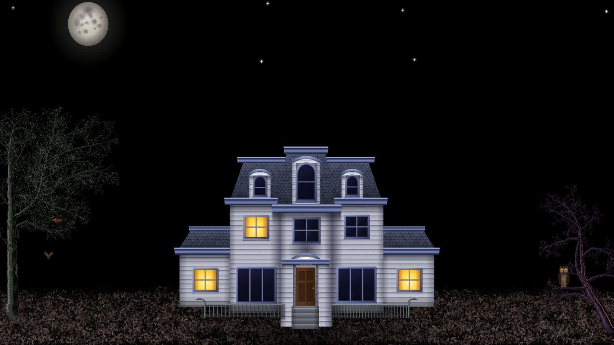
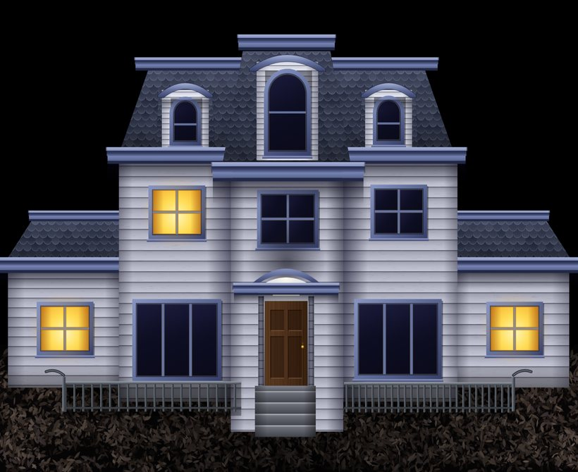

# ReMystery

A high-resolution recreation of the Windows 98 **Mystery** screensaver, the haunted house under a full moon, for macOS and Windows.



The artwork is drawn in code, so the scene stays sharp at any resolution, from 4K and 5K to ultrawide and portrait screens. The organ music and the sound effects are public-domain recordings: the organ cue is the original's chord progression played on real sampled church pipes. Everything fits in a single HTML file of about 330 KB, and no original Microsoft artwork or audio is included.

## What happens in the scene

- The pipe organ plays when the screensaver starts, and again each time the moon begins a new pass across the sky.
- The moon drifts slowly from left to right.
- The front door creaks open onto a dark hallway, first after about 11 seconds and then every minute or so.
- In the study window, a bearded man reads by candlelight for a few seconds every half minute.
- Seven windows light up and go dark on their own schedules.
- The owl in the dead tree blinks and calls about every 30 seconds.
- Two bats cross the sky, a black cat strolls past now and then, the stars twinkle, and a distant howl sounds about every 11 minutes.

The positions, timings and draw order follow the original scene. [docs/ORIGINAL.md](docs/ORIGINAL.md) has the details.



## Install

### macOS

Requires macOS 12 or later. It was built and tested on macOS 27.

1. Download `ReMystery-macOS.zip` from the Releases page and unzip it.
2. Double-click `ReMystery.saver` and install it.
3. The build is not notarized, so macOS may block it. Open **System Settings → Privacy & Security** and click **Open Anyway**, or clear the quarantine flag:

   ```bash
   xattr -dr com.apple.quarantine ~/Library/Screen\ Savers/ReMystery.saver
   ```

4. Pick **ReMystery** in **System Settings → Screen Saver**. **Options…** turns the sound on or off.

Sound plays on the main display only, and the preview in System Settings is always silent.

### Windows 11

1. Download `ReMystery-x64.scr`, or `ReMystery-arm64.scr` for ARM devices.
2. Right-click the file and choose **Install**. To keep it in the list permanently, copy it to `C:\Windows\System32` first.
3. Pick **ReMystery** in **Settings → Personalization → Lock screen → Screen saver**. **Settings…** turns the sound on or off.

The screensaver uses the Microsoft Edge WebView2 Runtime, which ships with Windows 11. SmartScreen may warn about the file because it is not code-signed.

## Try it in a browser

Open `src/index.html` in any modern browser. Browsers block sound until you click once.

These URL parameters help when working on the scene:

| Parameter | Effect |
|---|---|
| `sound=0` | Mute |
| `volume=0.5` | Play quieter; `0` keeps the audio running silently |
| `speed=10` | Run the clock ten times faster |
| `at=95000` | Start 95 seconds in (the cat first appears at 90 s) |
| `seed=1` | Fixed randomness, so leaves and timings repeat |
| `debug=sprites` | Show every animated frame on one sheet |
| `debug=trees` | Show only the trees, on grey |

## Build from source

**macOS** needs the Xcode command line tools.

```bash
./macos/build.sh
```

This produces `build/ReMystery.saver`, a universal arm64 and x86_64 bundle, and `build/ReMystery-macOS.zip`. The bundle is ad-hoc signed. Set `SIGN_IDENTITY` to a Developer ID identity to sign it for distribution.

**Windows** needs Visual Studio 2022 or its Build Tools with the C++ workload.

```bash
pwsh windows/build.ps1 -Arch x64
```

This produces `build/ReMystery-x64.scr`, a single self-contained file. The first run downloads the WebView2 SDK from NuGet. Use `-Arch arm64` for ARM.

GitHub Actions builds both platforms on every push and publishes a release for tags named `v*`.

## How it works

- **`src/index.html`** is the whole scene. The house, trees, leaves, moon and every animated sprite are drawn with the Canvas 2D API at the screen's native resolution. A small engine runs each object's script the way the original did, on a 55 ms tick. The sounds are embedded MP3s played through WebAudio.
- **`tools/sounds/`** rebuilds those sounds from CC0 recordings. [SOURCES.md](tools/sounds/SOURCES.md) credits each recording and explains how the organ cue is assembled.
- **`macos/`** holds a `ScreenSaverView` that hosts the page in a `WKWebView`.
- **`windows/`** holds a Win32 `.scr` that hosts the page in WebView2. It follows the standard `/s`, `/p` and `/c` screensaver protocol, covers every monitor, and quits on any input.

## Credits

The original Mystery screensaver came with Microsoft Plus! for Windows 95 and the Windows 98 desktop themes. ReMystery is an independent fan recreation, not affiliated with or endorsed by Microsoft. The artwork was created from scratch for this project, and the sounds come from public-domain recordings listed in [SOURCES.md](tools/sounds/SOURCES.md).

## License

[MIT](LICENSE)
